# Wallpaper Atlas

A curated directory of wallpaper collections for Windows, Linux, macOS, Android and iPhone. Discover your next desktop or mobile background without installing anything.

  

**[Browse the wallpaper gallery](https://ruslanlap.github.io/Wallpaper-Atlas/)** · [Desktop](#desktop) · [Mobile](#mobile) · [Setup](#set-your-wallpaper) · [Credits & rights](#credits--rights)

Wallpaper Atlas is a directory of independent collections. Open `index.html` in a browser to search and filter sources; choose an image on the original site and download it there. It does not bundle the images or install software.

## Browse directly on GitHub

| Desktop · Windows / Linux / macOS | Mobile · Android / iPhone |
|---|---|
| [110 wallpapers](wallpapers/desktop/README.md) | [89 wallpapers](wallpapers/mobile/README.md) |

[Machine-readable catalog](data/wallpapers.json) · [Image credits](ATTRIBUTION.md) · [Download originals](scripts/README.md)

The repository includes 24 lightweight preview files and a complete index of 199 originals. Original image binaries are downloaded on demand.

## Visual gallery

The site now features 199 wallpapers: 110 landscape images and 89 portrait images from ML4W, elementary wallpapers and The Wallpaper Collection, with verified image dimensions, direct original-image links and per-image source attribution. Images load from upstream, pinned to a commit; they are not mirrored in this repository. Android and iPhone filters show portrait images; source collections remain available below the gallery.

### Wallpapers to preview

Click an image to open its original. Credits and license details are in [Image sources and rights](ATTRIBUTION.md). The elementary previews load full-size originals from upstream.

|  |  | [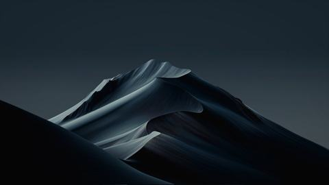](https://raw.githubusercontent.com/mylinuxforwork/wallpaper/9e9d463d80e6090e1a60cfdfbd17dcd82eddd779/mojave-dark-mode.png) |
| --- | --- | --- |
| [Mountain lake](https://github.com/mylinuxforwork/wallpaper/blob/9e9d463d80e6090e1a60cfdfbd17dcd82eddd779/mountain-lake.jpg) | [Lofoten at sundown](https://github.com/mylinuxforwork/wallpaper/blob/9e9d463d80e6090e1a60cfdfbd17dcd82eddd779/lofoten-sundown.jpg) | [Mojave after dark](https://github.com/mylinuxforwork/wallpaper/blob/9e9d463d80e6090e1a60cfdfbd17dcd82eddd779/mojave-dark-mode.png) |

| [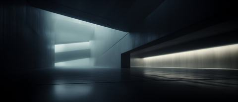](https://raw.githubusercontent.com/mylinuxforwork/wallpaper/9e9d463d80e6090e1a60cfdfbd17dcd82eddd779/minimal-beton-building.jpg) |  |  |
| --- | --- | --- |
| [Concrete study](https://github.com/mylinuxforwork/wallpaper/blob/9e9d463d80e6090e1a60cfdfbd17dcd82eddd779/minimal-beton-building.jpg) | [Nebula](https://github.com/mylinuxforwork/wallpaper/blob/9e9d463d80e6090e1a60cfdfbd17dcd82eddd779/Space-Nebula.png) | [Dark abstraction](https://github.com/mylinuxforwork/wallpaper/blob/9e9d463d80e6090e1a60cfdfbd17dcd82eddd779/abstract-dark.png) |

| [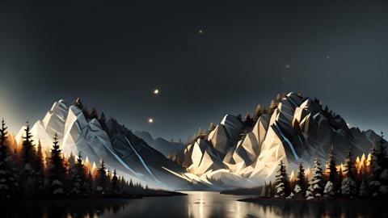](https://raw.githubusercontent.com/mylinuxforwork/wallpaper/9e9d463d80e6090e1a60cfdfbd17dcd82eddd779/northern-night.jpg) | [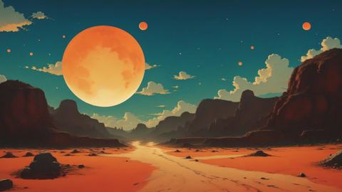](https://raw.githubusercontent.com/mylinuxforwork/wallpaper/9e9d463d80e6090e1a60cfdfbd17dcd82eddd779/orange-desert.jpg) |  |
| --- | --- | --- |
| [Northern night](https://github.com/mylinuxforwork/wallpaper/blob/9e9d463d80e6090e1a60cfdfbd17dcd82eddd779/northern-night.jpg) | [Orange desert](https://github.com/mylinuxforwork/wallpaper/blob/9e9d463d80e6090e1a60cfdfbd17dcd82eddd779/orange-desert.jpg) | [Quiet geometry](https://github.com/mylinuxforwork/wallpaper/blob/9e9d463d80e6090e1a60cfdfbd17dcd82eddd779/minimal-boxes.jpg) |

|  |  | [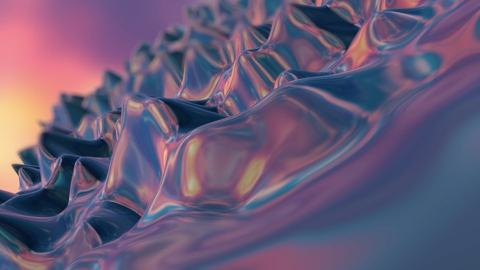](https://raw.githubusercontent.com/mylinuxforwork/wallpaper/9e9d463d80e6090e1a60cfdfbd17dcd82eddd779/plasmawaves.png) |
| --- | --- | --- |
| [Moonlight](https://github.com/mylinuxforwork/wallpaper/blob/9e9d463d80e6090e1a60cfdfbd17dcd82eddd779/moonlight.jpg) | [Marina Bay](https://github.com/mylinuxforwork/wallpaper/blob/9e9d463d80e6090e1a60cfdfbd17dcd82eddd779/marina-bay-sands.png) | [Plasma waves](https://github.com/mylinuxforwork/wallpaper/blob/9e9d463d80e6090e1a60cfdfbd17dcd82eddd779/plasmawaves.png) |

| [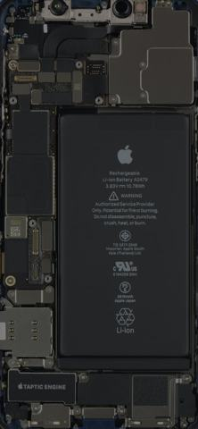](https://raw.githubusercontent.com/MilesCorporate/The-Wallpaper-Collection/eba6de2ddad441b2bcaafe5c50e5b2c8df51a9b0/Phone%20Wallpapers/iPhone%2012%20Dark.jpg) | [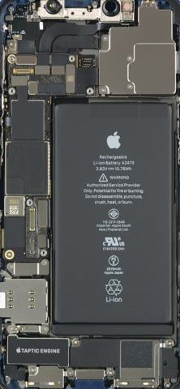](https://raw.githubusercontent.com/MilesCorporate/The-Wallpaper-Collection/eba6de2ddad441b2bcaafe5c50e5b2c8df51a9b0/Phone%20Wallpapers/iPhone%2012.jpg) | [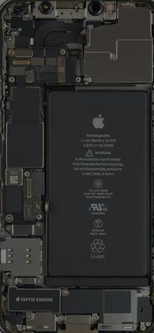](https://raw.githubusercontent.com/MilesCorporate/The-Wallpaper-Collection/eba6de2ddad441b2bcaafe5c50e5b2c8df51a9b0/Phone%20Wallpapers/iPhone%2012%20Pro%20Dark.jpg) |
| --- | --- | --- |
| [Midnight spectrum](https://github.com/MilesCorporate/The-Wallpaper-Collection/blob/eba6de2ddad441b2bcaafe5c50e5b2c8df51a9b0/Phone%20Wallpapers/iPhone%2012%20Dark.jpg) | [Color spectrum](https://github.com/MilesCorporate/The-Wallpaper-Collection/blob/eba6de2ddad441b2bcaafe5c50e5b2c8df51a9b0/Phone%20Wallpapers/iPhone%2012.jpg) | [Dark geometry](https://github.com/MilesCorporate/The-Wallpaper-Collection/blob/eba6de2ddad441b2bcaafe5c50e5b2c8df51a9b0/Phone%20Wallpapers/iPhone%2012%20Pro%20Dark.jpg) |

| [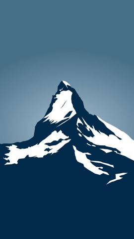](https://raw.githubusercontent.com/MilesCorporate/The-Wallpaper-Collection/eba6de2ddad441b2bcaafe5c50e5b2c8df51a9b0/Phone%20Wallpapers/Marmotamaps_Wallpaper_Matterhorn_Smartphone_1080x1920.jpg) | [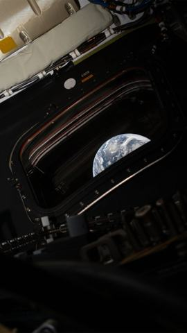](https://raw.githubusercontent.com/MilesCorporate/The-Wallpaper-Collection/eba6de2ddad441b2bcaafe5c50e5b2c8df51a9b0/Phone%20Wallpapers/02-artemis-ii-wallpaper-looking-back-at-earth-image.jpg) | [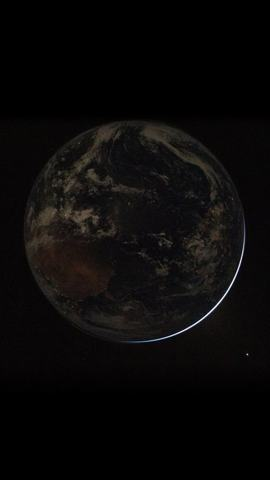](https://raw.githubusercontent.com/MilesCorporate/The-Wallpaper-Collection/eba6de2ddad441b2bcaafe5c50e5b2c8df51a9b0/Phone%20Wallpapers/08-artemis-ii-wallpaper-backlit-earth-image.jpg) |
| --- | --- | --- |
| [Matterhorn map](https://github.com/MilesCorporate/The-Wallpaper-Collection/blob/eba6de2ddad441b2bcaafe5c50e5b2c8df51a9b0/Phone%20Wallpapers/Marmotamaps_Wallpaper_Matterhorn_Smartphone_1080x1920.jpg) | [Looking back at Earth](https://github.com/MilesCorporate/The-Wallpaper-Collection/blob/eba6de2ddad441b2bcaafe5c50e5b2c8df51a9b0/Phone%20Wallpapers/02-artemis-ii-wallpaper-looking-back-at-earth-image.jpg) | [Backlit Earth](https://github.com/MilesCorporate/The-Wallpaper-Collection/blob/eba6de2ddad441b2bcaafe5c50e5b2c8df51a9b0/Phone%20Wallpapers/08-artemis-ii-wallpaper-backlit-earth-image.jpg) |

| [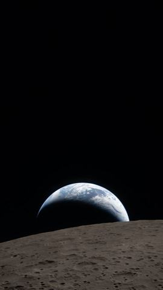](https://raw.githubusercontent.com/MilesCorporate/The-Wallpaper-Collection/eba6de2ddad441b2bcaafe5c50e5b2c8df51a9b0/Phone%20Wallpapers/02-artemis-ii-lunar-flyby-wallpaper-earthset-image.jpg) | [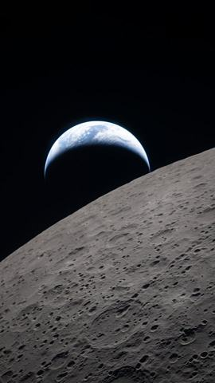](https://raw.githubusercontent.com/MilesCorporate/The-Wallpaper-Collection/eba6de2ddad441b2bcaafe5c50e5b2c8df51a9b0/Phone%20Wallpapers/04-artemis-ii-lunar-flyby-wallpaper-peeking-at-earth-image.jpg) | [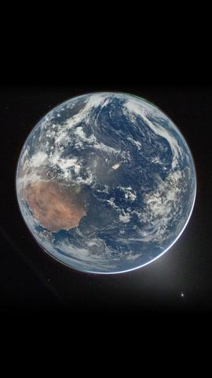](https://raw.githubusercontent.com/MilesCorporate/The-Wallpaper-Collection/eba6de2ddad441b2bcaafe5c50e5b2c8df51a9b0/Phone%20Wallpapers/04-artemis-ii-wallpaper-earth-perspective-image.jpg) |
| --- | --- | --- |
| [02 artemis ii lunar flyby wallpaper earthset image](https://github.com/MilesCorporate/The-Wallpaper-Collection/blob/eba6de2ddad441b2bcaafe5c50e5b2c8df51a9b0/Phone%20Wallpapers/02-artemis-ii-lunar-flyby-wallpaper-earthset-image.jpg) | [04 artemis ii lunar flyby wallpaper peeking at earth image](https://github.com/MilesCorporate/The-Wallpaper-Collection/blob/eba6de2ddad441b2bcaafe5c50e5b2c8df51a9b0/Phone%20Wallpapers/04-artemis-ii-lunar-flyby-wallpaper-peeking-at-earth-image.jpg) | [04 artemis ii wallpaper earth perspective image](https://github.com/MilesCorporate/The-Wallpaper-Collection/blob/eba6de2ddad441b2bcaafe5c50e5b2c8df51a9b0/Phone%20Wallpapers/04-artemis-ii-wallpaper-earth-perspective-image.jpg) |

| [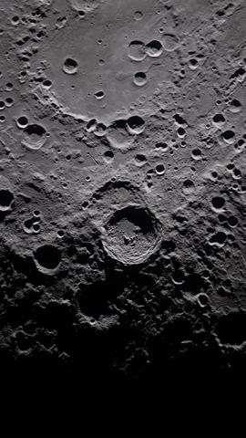](https://raw.githubusercontent.com/MilesCorporate/The-Wallpaper-Collection/eba6de2ddad441b2bcaafe5c50e5b2c8df51a9b0/Phone%20Wallpapers/06-artemis-ii-lunar-flyby-wallpaper-vavilov-crater-image.jpg) | [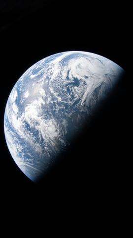](https://raw.githubusercontent.com/MilesCorporate/The-Wallpaper-Collection/eba6de2ddad441b2bcaafe5c50e5b2c8df51a9b0/Phone%20Wallpapers/06-artemis-ii-wallpaper-earth-views-from-the-artemis-ii-crew-image.jpg) | [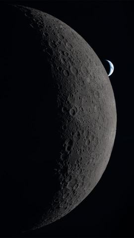](https://raw.githubusercontent.com/MilesCorporate/The-Wallpaper-Collection/eba6de2ddad441b2bcaafe5c50e5b2c8df51a9b0/Phone%20Wallpapers/08-artemis-ii-lunar-flyby-wallpaper-new-moon-view-image.jpg) |
| --- | --- | --- |
| [06 artemis ii lunar flyby wallpaper vavilov crater image](https://github.com/MilesCorporate/The-Wallpaper-Collection/blob/eba6de2ddad441b2bcaafe5c50e5b2c8df51a9b0/Phone%20Wallpapers/06-artemis-ii-lunar-flyby-wallpaper-vavilov-crater-image.jpg) | [06 artemis ii wallpaper earth views from the artemis ii crew i…](https://github.com/MilesCorporate/The-Wallpaper-Collection/blob/eba6de2ddad441b2bcaafe5c50e5b2c8df51a9b0/Phone%20Wallpapers/06-artemis-ii-wallpaper-earth-views-from-the-artemis-ii-crew-image.jpg) | [08 artemis ii lunar flyby wallpaper new moon view image](https://github.com/MilesCorporate/The-Wallpaper-Collection/blob/eba6de2ddad441b2bcaafe5c50e5b2c8df51a9b0/Phone%20Wallpapers/08-artemis-ii-lunar-flyby-wallpaper-new-moon-view-image.jpg) |

|  |  |  |
| --- | --- | --- |
| [A Large Body of Water Surrounded By Mountains](https://github.com/elementary/wallpapers/blob/a533370e8e70309b16d34bd1389cd6295310be69/backgrounds/A%20Large%20Body%20of%20Water%20Surrounded%20By%20Mountains.jpg) | [Ashim DSilva](https://github.com/elementary/wallpapers/blob/a533370e8e70309b16d34bd1389cd6295310be69/backgrounds/Ashim%20DSilva.jpg) | [Canazei Granite Ridges](https://github.com/elementary/wallpapers/blob/a533370e8e70309b16d34bd1389cd6295310be69/backgrounds/Canazei%20Granite%20Ridges.jpg) |

|  |  |  |
| --- | --- | --- |
| [Martin Adams](https://github.com/elementary/wallpapers/blob/a533370e8e70309b16d34bd1389cd6295310be69/backgrounds/Martin%20Adams.jpg) | [Morskie Oko](https://github.com/elementary/wallpapers/blob/a533370e8e70309b16d34bd1389cd6295310be69/backgrounds/Morskie%20Oko.jpg) | [Mr. Lee](https://github.com/elementary/wallpapers/blob/a533370e8e70309b16d34bd1389cd6295310be69/backgrounds/Mr.%20Lee.jpg) |

|  |  |  |
| --- | --- | --- |
| [Nattu Adnan](https://github.com/elementary/wallpapers/blob/a533370e8e70309b16d34bd1389cd6295310be69/backgrounds/Nattu%20Adnan.jpg) | [Photo by SpaceX](https://github.com/elementary/wallpapers/blob/a533370e8e70309b16d34bd1389cd6295310be69/backgrounds/Photo%20by%20SpaceX.jpg) | [Photo of Valley](https://github.com/elementary/wallpapers/blob/a533370e8e70309b16d34bd1389cd6295310be69/backgrounds/Photo%20of%20Valley.jpg) |

|  |  |  |
| --- | --- | --- |
| [Snow-Capped Mountain](https://github.com/elementary/wallpapers/blob/a533370e8e70309b16d34bd1389cd6295310be69/backgrounds/Snow-Capped%20Mountain.jpg) | [Sunset by the Pier](https://github.com/elementary/wallpapers/blob/a533370e8e70309b16d34bd1389cd6295310be69/backgrounds/Sunset%20by%20the%20Pier.jpg) | [Tj Holowaychuk](https://github.com/elementary/wallpapers/blob/a533370e8e70309b16d34bd1389cd6295310be69/backgrounds/Tj%20Holowaychuk.jpg) |

|  |  |  |
| --- | --- | --- |
| [Viktor Forgacs](https://github.com/elementary/wallpapers/blob/a533370e8e70309b16d34bd1389cd6295310be69/backgrounds/Viktor%20Forgacs.jpg) | [odin-dark](https://github.com/elementary/wallpapers/blob/a533370e8e70309b16d34bd1389cd6295310be69/backgrounds/odin-dark.jpg) | [odin](https://github.com/elementary/wallpapers/blob/a533370e8e70309b16d34bd1389cd6295310be69/backgrounds/odin.jpg) |

## What you can do

- Search featured wallpapers by name, style or platform; explore 11 source collections below.
- Save favorites locally in your browser (no account required).
- Share a filtered search using the URL fragment when hosted.
- Open an original image or inspect its exact upstream source.

## Desktop

| Collection | Explore | What to expect |
| --- | --- | --- |
| ML4W | [mylinuxforwork](https://github.com/mylinuxforwork/wallpaper) | Collection for tiling window managers |
| Categorized Walls | [dharmx](https://github.com/dharmx/walls) | Categorized wallpaper showcase |
| Original Walls | [orangci](https://github.com/orangci/walls) | Original colors; README links to the newer collection home |
| Wallpaper Bank | [JaKooLit](https://github.com/JaKooLit/Wallpaper-Bank) | A wide variety of wallpapers, popular in Linux customization |
| Catppuccin Mocha | [orangci](https://github.com/orangci/walls-catppuccin-mocha) | Wallpapers adapted to the Mocha palette |
| EndeavourOS | [Official branding](https://github.com/endeavouros-team/Branding) | Official wallpapers and branding assets |
| Linux distros | [Distro-wallpapers](https://github.com/LinuxKits/Distro-wallpapers) | Artwork organized by Linux distribution |
| OS wallpapers | [OS Wallpapers](https://github.com/Tcode-Motion/os-wallpapers) | A desktop-oriented operating-system collection |
| elementary OS | [elementary/wallpapers](https://github.com/elementary/wallpapers) | Wallpapers from elementary OS |

## Mobile

| Collection | Explore | What to expect |
| --- | --- | --- |
| The Wallpaper Collection | [Phone Wallpapers](https://github.com/MilesCorporate/The-Wallpaper-Collection) | A collection with a dedicated portrait phone section |
| Vibe wallpapers | [vibe-dev/wallpapers](https://github.com/vibe-dev/wallpapers) | Fractal designs with documented phone sizes |

Landscape images can work on mobile with cropping; pick portrait files when available. Check image resolution and aspect ratio before downloading.

## Set your wallpaper

Download the original image to your device first. Menu names may vary by OS version.

- **Windows 10/11:** right-click the image in File Explorer → **Set as desktop background**. Or go to Settings → Personalization → Background.
- **macOS:** Control-click the image in Finder → **Set Desktop Picture**. Alternatively, use System Settings → Wallpaper → Add Photo.
- **Linux:** use your desktop's background settings. In GNOME, open Settings → Background; in KDE Plasma, right-click the desktop → Configure Desktop and Wallpaper. On Hyprland/Omarchy, use the wallpaper selector provided by your setup.
- **Android:** open the image in Photos/Gallery → menu → Set as wallpaper; choose home screen, lock screen, or both.
- **iPhone:** save the image to Photos → open it → Share → Use as Wallpaper. Adjust the crop and choose where to apply it.

## Credits & rights

This directory links to third-party repositories. Each source retains its own terms. A repository license may cover code without granting rights to every image; check the original artist and license for each image before redistribution, modification, or commercial use. The orangci collection states that its maintainer did not create the wallpapers and edited some of them. If a creator or rights holder wants a link corrected or removed, please open an issue.

## Contributing

Found a collection we should include? [Suggest it](https://github.com/ruslanlap/Wallpaper-Atlas/issues/new/choose) or read the [contribution guide](CONTRIBUTING.md).

## License

The project code and its own documentation are available under the [MIT license](LICENSE). Third-party images and collections have their own terms; this license does not grant rights to them.

## Run locally

Download the repository and open `index.html`. No build step or dependencies are needed. Favorites stay in this browser and may be unavailable in private browsing.

## Publish with GitHub Pages

In repository Settings → Pages, select **GitHub Actions** as the publishing source. Then run the **Publish Pages** workflow from Actions. Later pushes to `master` republish automatically. The workflow deploys only the site and its guide.

## Development

Run `node --test tests/*.test.cjs`. CI checks the catalog structure and JavaScript syntax; it does not claim that external links are reachable or that image rights have been reviewed.

### Expanded index

The gallery includes 199 remote images (110 landscape, 89 portrait). Image headers were checked for dimensions; entries below 720 pixels on either side and non-portrait files in the phone selection were excluded. Titles derive from source filenames and style labels are best-effort categories, not artist-verified descriptions. Each original URL is pinned to a source commit. The gallery renders 12 results at a time; Show 12 more adds the next group. Originals may still be large downloads.
