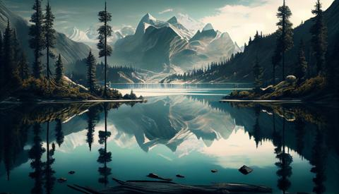
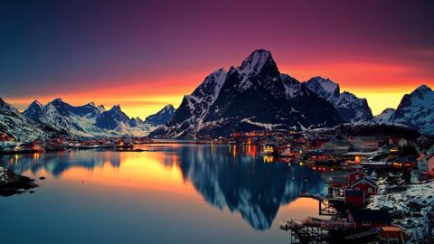
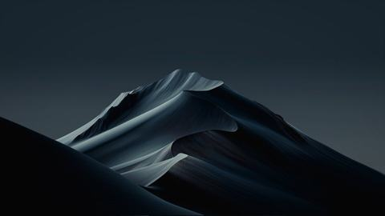
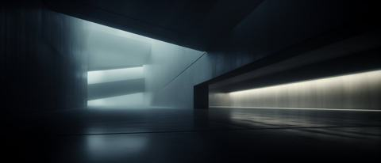
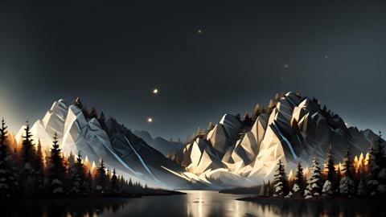
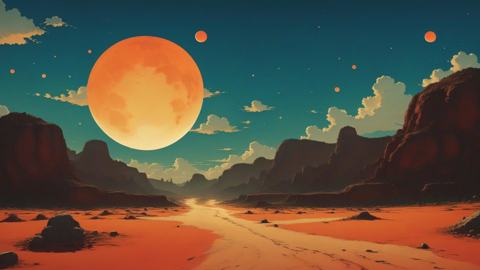
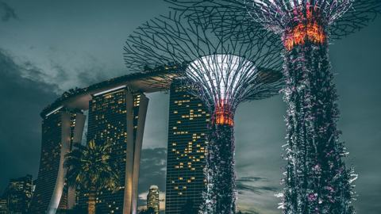
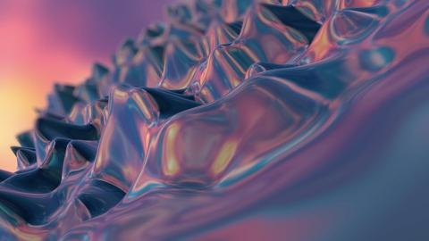

# Desktop wallpapers

110 original images. Preview images are reduced-size browsing aids; use **Original** for full resolution.

### Mountain lake

3200 × 1829 · [ML4W](https://github.com/mylinuxforwork/wallpaper/blob/9e9d463d80e6090e1a60cfdfbd17dcd82eddd779/mountain-lake.jpg) · [Original](https://raw.githubusercontent.com/mylinuxforwork/wallpaper/9e9d463d80e6090e1a60cfdfbd17dcd82eddd779/mountain-lake.jpg)

### Lofoten at sundown

3840 × 2160 · [ML4W](https://github.com/mylinuxforwork/wallpaper/blob/9e9d463d80e6090e1a60cfdfbd17dcd82eddd779/lofoten-sundown.jpg) · [Original](https://raw.githubusercontent.com/mylinuxforwork/wallpaper/9e9d463d80e6090e1a60cfdfbd17dcd82eddd779/lofoten-sundown.jpg)

### Mojave after dark

3840 × 2160 · [ML4W](https://github.com/mylinuxforwork/wallpaper/blob/9e9d463d80e6090e1a60cfdfbd17dcd82eddd779/mojave-dark-mode.png) · [Original](https://raw.githubusercontent.com/mylinuxforwork/wallpaper/9e9d463d80e6090e1a60cfdfbd17dcd82eddd779/mojave-dark-mode.png)

### Concrete study

3360 × 1440 · [ML4W](https://github.com/mylinuxforwork/wallpaper/blob/9e9d463d80e6090e1a60cfdfbd17dcd82eddd779/minimal-beton-building.jpg) · [Original](https://raw.githubusercontent.com/mylinuxforwork/wallpaper/9e9d463d80e6090e1a60cfdfbd17dcd82eddd779/minimal-beton-building.jpg)

### Nebula

5824 × 3264 · [ML4W](https://github.com/mylinuxforwork/wallpaper/blob/9e9d463d80e6090e1a60cfdfbd17dcd82eddd779/Space-Nebula.png) · [Original](https://raw.githubusercontent.com/mylinuxforwork/wallpaper/9e9d463d80e6090e1a60cfdfbd17dcd82eddd779/Space-Nebula.png)

### Dark abstraction

3840 × 2160 · [ML4W](https://github.com/mylinuxforwork/wallpaper/blob/9e9d463d80e6090e1a60cfdfbd17dcd82eddd779/abstract-dark.png) · [Original](https://raw.githubusercontent.com/mylinuxforwork/wallpaper/9e9d463d80e6090e1a60cfdfbd17dcd82eddd779/abstract-dark.png)

### Northern night

3840 × 2160 · [ML4W](https://github.com/mylinuxforwork/wallpaper/blob/9e9d463d80e6090e1a60cfdfbd17dcd82eddd779/northern-night.jpg) · [Original](https://raw.githubusercontent.com/mylinuxforwork/wallpaper/9e9d463d80e6090e1a60cfdfbd17dcd82eddd779/northern-night.jpg)

### Orange desert

2560 × 1440 · [ML4W](https://github.com/mylinuxforwork/wallpaper/blob/9e9d463d80e6090e1a60cfdfbd17dcd82eddd779/orange-desert.jpg) · [Original](https://raw.githubusercontent.com/mylinuxforwork/wallpaper/9e9d463d80e6090e1a60cfdfbd17dcd82eddd779/orange-desert.jpg)

### Quiet geometry

3413 × 1920 · [ML4W](https://github.com/mylinuxforwork/wallpaper/blob/9e9d463d80e6090e1a60cfdfbd17dcd82eddd779/minimal-boxes.jpg) · [Original](https://raw.githubusercontent.com/mylinuxforwork/wallpaper/9e9d463d80e6090e1a60cfdfbd17dcd82eddd779/minimal-boxes.jpg)

### Moonlight

3840 × 2160 · [ML4W](https://github.com/mylinuxforwork/wallpaper/blob/9e9d463d80e6090e1a60cfdfbd17dcd82eddd779/moonlight.jpg) · [Original](https://raw.githubusercontent.com/mylinuxforwork/wallpaper/9e9d463d80e6090e1a60cfdfbd17dcd82eddd779/moonlight.jpg)

### Marina Bay

3840 × 2160 · [ML4W](https://github.com/mylinuxforwork/wallpaper/blob/9e9d463d80e6090e1a60cfdfbd17dcd82eddd779/marina-bay-sands.png) · [Original](https://raw.githubusercontent.com/mylinuxforwork/wallpaper/9e9d463d80e6090e1a60cfdfbd17dcd82eddd779/marina-bay-sands.png)

### Plasma waves

5120 × 2880 · [ML4W](https://github.com/mylinuxforwork/wallpaper/blob/9e9d463d80e6090e1a60cfdfbd17dcd82eddd779/plasmawaves.png) · [Original](https://raw.githubusercontent.com/mylinuxforwork/wallpaper/9e9d463d80e6090e1a60cfdfbd17dcd82eddd779/plasmawaves.png)

## Complete index
| Wallpaper | Resolution | Source |
|---|---|---|
| [Mountain lake](https://raw.githubusercontent.com/mylinuxforwork/wallpaper/9e9d463d80e6090e1a60cfdfbd17dcd82eddd779/mountain-lake.jpg) | 3200 × 1829 | [ML4W](https://github.com/mylinuxforwork/wallpaper/blob/9e9d463d80e6090e1a60cfdfbd17dcd82eddd779/mountain-lake.jpg) |
| [Lofoten at sundown](https://raw.githubusercontent.com/mylinuxforwork/wallpaper/9e9d463d80e6090e1a60cfdfbd17dcd82eddd779/lofoten-sundown.jpg) | 3840 × 2160 | [ML4W](https://github.com/mylinuxforwork/wallpaper/blob/9e9d463d80e6090e1a60cfdfbd17dcd82eddd779/lofoten-sundown.jpg) |
| [Mojave after dark](https://raw.githubusercontent.com/mylinuxforwork/wallpaper/9e9d463d80e6090e1a60cfdfbd17dcd82eddd779/mojave-dark-mode.png) | 3840 × 2160 | [ML4W](https://github.com/mylinuxforwork/wallpaper/blob/9e9d463d80e6090e1a60cfdfbd17dcd82eddd779/mojave-dark-mode.png) |
| [Concrete study](https://raw.githubusercontent.com/mylinuxforwork/wallpaper/9e9d463d80e6090e1a60cfdfbd17dcd82eddd779/minimal-beton-building.jpg) | 3360 × 1440 | [ML4W](https://github.com/mylinuxforwork/wallpaper/blob/9e9d463d80e6090e1a60cfdfbd17dcd82eddd779/minimal-beton-building.jpg) |
| [Nebula](https://raw.githubusercontent.com/mylinuxforwork/wallpaper/9e9d463d80e6090e1a60cfdfbd17dcd82eddd779/Space-Nebula.png) | 5824 × 3264 | [ML4W](https://github.com/mylinuxforwork/wallpaper/blob/9e9d463d80e6090e1a60cfdfbd17dcd82eddd779/Space-Nebula.png) |
| [Dark abstraction](https://raw.githubusercontent.com/mylinuxforwork/wallpaper/9e9d463d80e6090e1a60cfdfbd17dcd82eddd779/abstract-dark.png) | 3840 × 2160 | [ML4W](https://github.com/mylinuxforwork/wallpaper/blob/9e9d463d80e6090e1a60cfdfbd17dcd82eddd779/abstract-dark.png) |
| [Northern night](https://raw.githubusercontent.com/mylinuxforwork/wallpaper/9e9d463d80e6090e1a60cfdfbd17dcd82eddd779/northern-night.jpg) | 3840 × 2160 | [ML4W](https://github.com/mylinuxforwork/wallpaper/blob/9e9d463d80e6090e1a60cfdfbd17dcd82eddd779/northern-night.jpg) |
| [Orange desert](https://raw.githubusercontent.com/mylinuxforwork/wallpaper/9e9d463d80e6090e1a60cfdfbd17dcd82eddd779/orange-desert.jpg) | 2560 × 1440 | [ML4W](https://github.com/mylinuxforwork/wallpaper/blob/9e9d463d80e6090e1a60cfdfbd17dcd82eddd779/orange-desert.jpg) |
| [Quiet geometry](https://raw.githubusercontent.com/mylinuxforwork/wallpaper/9e9d463d80e6090e1a60cfdfbd17dcd82eddd779/minimal-boxes.jpg) | 3413 × 1920 | [ML4W](https://github.com/mylinuxforwork/wallpaper/blob/9e9d463d80e6090e1a60cfdfbd17dcd82eddd779/minimal-boxes.jpg) |
| [Moonlight](https://raw.githubusercontent.com/mylinuxforwork/wallpaper/9e9d463d80e6090e1a60cfdfbd17dcd82eddd779/moonlight.jpg) | 3840 × 2160 | [ML4W](https://github.com/mylinuxforwork/wallpaper/blob/9e9d463d80e6090e1a60cfdfbd17dcd82eddd779/moonlight.jpg) |
| [Marina Bay](https://raw.githubusercontent.com/mylinuxforwork/wallpaper/9e9d463d80e6090e1a60cfdfbd17dcd82eddd779/marina-bay-sands.png) | 3840 × 2160 | [ML4W](https://github.com/mylinuxforwork/wallpaper/blob/9e9d463d80e6090e1a60cfdfbd17dcd82eddd779/marina-bay-sands.png) |
| [Plasma waves](https://raw.githubusercontent.com/mylinuxforwork/wallpaper/9e9d463d80e6090e1a60cfdfbd17dcd82eddd779/plasmawaves.png) | 5120 × 2880 | [ML4W](https://github.com/mylinuxforwork/wallpaper/blob/9e9d463d80e6090e1a60cfdfbd17dcd82eddd779/plasmawaves.png) |
| [3d tech](https://raw.githubusercontent.com/mylinuxforwork/wallpaper/9e9d463d80e6090e1a60cfdfbd17dcd82eddd779/3d-tech.jpg) | 3840 × 2160 | [ML4W](https://github.com/mylinuxforwork/wallpaper/blob/9e9d463d80e6090e1a60cfdfbd17dcd82eddd779/3d-tech.jpg) |
| [Desert with mountains moon](https://raw.githubusercontent.com/mylinuxforwork/wallpaper/9e9d463d80e6090e1a60cfdfbd17dcd82eddd779/Desert-With-Mountains-Moon.jpg) | 2560 × 1440 | [ML4W](https://github.com/mylinuxforwork/wallpaper/blob/9e9d463d80e6090e1a60cfdfbd17dcd82eddd779/Desert-With-Mountains-Moon.jpg) |
| [Fantasy autumn](https://raw.githubusercontent.com/mylinuxforwork/wallpaper/9e9d463d80e6090e1a60cfdfbd17dcd82eddd779/Fantasy-Autumn.png) | 1920 × 1080 | [ML4W](https://github.com/mylinuxforwork/wallpaper/blob/9e9d463d80e6090e1a60cfdfbd17dcd82eddd779/Fantasy-Autumn.png) |
| [Fantasy landscape3](https://raw.githubusercontent.com/mylinuxforwork/wallpaper/9e9d463d80e6090e1a60cfdfbd17dcd82eddd779/Fantasy-Landscape3.png) | 3831 × 2160 | [ML4W](https://github.com/mylinuxforwork/wallpaper/blob/9e9d463d80e6090e1a60cfdfbd17dcd82eddd779/Fantasy-Landscape3.png) |
| [Nocturne of steel and glass](https://raw.githubusercontent.com/mylinuxforwork/wallpaper/9e9d463d80e6090e1a60cfdfbd17dcd82eddd779/Nocturne-of-Steel-and-Glass.png) | 2560 × 1600 | [ML4W](https://github.com/mylinuxforwork/wallpaper/blob/9e9d463d80e6090e1a60cfdfbd17dcd82eddd779/Nocturne-of-Steel-and-Glass.png) |
| [Solitary glow](https://raw.githubusercontent.com/mylinuxforwork/wallpaper/9e9d463d80e6090e1a60cfdfbd17dcd82eddd779/Solitary-Glow.png) | 2560 × 1600 | [ML4W](https://github.com/mylinuxforwork/wallpaper/blob/9e9d463d80e6090e1a60cfdfbd17dcd82eddd779/Solitary-Glow.png) |
| [Adwaita l](https://raw.githubusercontent.com/mylinuxforwork/wallpaper/9e9d463d80e6090e1a60cfdfbd17dcd82eddd779/adwaita-l.jpg) | 4096 × 4096 | [ML4W](https://github.com/mylinuxforwork/wallpaper/blob/9e9d463d80e6090e1a60cfdfbd17dcd82eddd779/adwaita-l.jpg) |
| [Aesthetic deer](https://raw.githubusercontent.com/mylinuxforwork/wallpaper/9e9d463d80e6090e1a60cfdfbd17dcd82eddd779/aesthetic_deer.jpg) | 3840 × 2160 | [ML4W](https://github.com/mylinuxforwork/wallpaper/blob/9e9d463d80e6090e1a60cfdfbd17dcd82eddd779/aesthetic_deer.jpg) |
| [African light](https://raw.githubusercontent.com/mylinuxforwork/wallpaper/9e9d463d80e6090e1a60cfdfbd17dcd82eddd779/african-light.jpg) | 4000 × 2242 | [ML4W](https://github.com/mylinuxforwork/wallpaper/blob/9e9d463d80e6090e1a60cfdfbd17dcd82eddd779/african-light.jpg) |
| [Ai machine](https://raw.githubusercontent.com/mylinuxforwork/wallpaper/9e9d463d80e6090e1a60cfdfbd17dcd82eddd779/ai-machine.png) | 3840 × 2160 | [ML4W](https://github.com/mylinuxforwork/wallpaper/blob/9e9d463d80e6090e1a60cfdfbd17dcd82eddd779/ai-machine.png) |
| [Amazing nature mountain](https://raw.githubusercontent.com/mylinuxforwork/wallpaper/9e9d463d80e6090e1a60cfdfbd17dcd82eddd779/amazing-nature-mountain.jpg) | 5696 × 3392 | [ML4W](https://github.com/mylinuxforwork/wallpaper/blob/9e9d463d80e6090e1a60cfdfbd17dcd82eddd779/amazing-nature-mountain.jpg) |
| [Amber island](https://raw.githubusercontent.com/mylinuxforwork/wallpaper/9e9d463d80e6090e1a60cfdfbd17dcd82eddd779/amber-island.jpg) | 2560 × 1440 | [ML4W](https://github.com/mylinuxforwork/wallpaper/blob/9e9d463d80e6090e1a60cfdfbd17dcd82eddd779/amber-island.jpg) |
| [Anime1](https://raw.githubusercontent.com/mylinuxforwork/wallpaper/9e9d463d80e6090e1a60cfdfbd17dcd82eddd779/anime1.png) | 3840 × 2160 | [ML4W](https://github.com/mylinuxforwork/wallpaper/blob/9e9d463d80e6090e1a60cfdfbd17dcd82eddd779/anime1.png) |
| [Anime2](https://raw.githubusercontent.com/mylinuxforwork/wallpaper/9e9d463d80e6090e1a60cfdfbd17dcd82eddd779/anime2.jpg) | 4096 × 1728 | [ML4W](https://github.com/mylinuxforwork/wallpaper/blob/9e9d463d80e6090e1a60cfdfbd17dcd82eddd779/anime2.jpg) |
| [Anime3](https://raw.githubusercontent.com/mylinuxforwork/wallpaper/9e9d463d80e6090e1a60cfdfbd17dcd82eddd779/anime3.png) | 5118 × 2878 | [ML4W](https://github.com/mylinuxforwork/wallpaper/blob/9e9d463d80e6090e1a60cfdfbd17dcd82eddd779/anime3.png) |
| [Apex octane](https://raw.githubusercontent.com/mylinuxforwork/wallpaper/9e9d463d80e6090e1a60cfdfbd17dcd82eddd779/apex_octane.jpg) | 5120 × 2880 | [ML4W](https://github.com/mylinuxforwork/wallpaper/blob/9e9d463d80e6090e1a60cfdfbd17dcd82eddd779/apex_octane.jpg) |
| [Apple dark](https://raw.githubusercontent.com/mylinuxforwork/wallpaper/9e9d463d80e6090e1a60cfdfbd17dcd82eddd779/apple-dark.jpg) | 6016 × 6016 | [ML4W](https://github.com/mylinuxforwork/wallpaper/blob/9e9d463d80e6090e1a60cfdfbd17dcd82eddd779/apple-dark.jpg) |
| [Apple light](https://raw.githubusercontent.com/mylinuxforwork/wallpaper/9e9d463d80e6090e1a60cfdfbd17dcd82eddd779/apple-light.jpg) | 6016 × 6016 | [ML4W](https://github.com/mylinuxforwork/wallpaper/blob/9e9d463d80e6090e1a60cfdfbd17dcd82eddd779/apple-light.jpg) |
| [Apple waves1](https://raw.githubusercontent.com/mylinuxforwork/wallpaper/9e9d463d80e6090e1a60cfdfbd17dcd82eddd779/apple-waves1.jpg) | 6016 × 6016 | [ML4W](https://github.com/mylinuxforwork/wallpaper/blob/9e9d463d80e6090e1a60cfdfbd17dcd82eddd779/apple-waves1.jpg) |
| [Arch1](https://raw.githubusercontent.com/mylinuxforwork/wallpaper/9e9d463d80e6090e1a60cfdfbd17dcd82eddd779/arch1.png) | 4096 × 2160 | [ML4W](https://github.com/mylinuxforwork/wallpaper/blob/9e9d463d80e6090e1a60cfdfbd17dcd82eddd779/arch1.png) |
| [Arch2](https://raw.githubusercontent.com/mylinuxforwork/wallpaper/9e9d463d80e6090e1a60cfdfbd17dcd82eddd779/arch2.jpg) | 6000 × 3375 | [ML4W](https://github.com/mylinuxforwork/wallpaper/blob/9e9d463d80e6090e1a60cfdfbd17dcd82eddd779/arch2.jpg) |
| [Arch3](https://raw.githubusercontent.com/mylinuxforwork/wallpaper/9e9d463d80e6090e1a60cfdfbd17dcd82eddd779/arch3.jpg) | 3840 × 2160 | [ML4W](https://github.com/mylinuxforwork/wallpaper/blob/9e9d463d80e6090e1a60cfdfbd17dcd82eddd779/arch3.jpg) |
| [Astronaut](https://raw.githubusercontent.com/mylinuxforwork/wallpaper/9e9d463d80e6090e1a60cfdfbd17dcd82eddd779/astronaut.png) | 7680 × 4320 | [ML4W](https://github.com/mylinuxforwork/wallpaper/blob/9e9d463d80e6090e1a60cfdfbd17dcd82eddd779/astronaut.png) |
| [Astronaut2](https://raw.githubusercontent.com/mylinuxforwork/wallpaper/9e9d463d80e6090e1a60cfdfbd17dcd82eddd779/astronaut2.png) | 3840 × 2160 | [ML4W](https://github.com/mylinuxforwork/wallpaper/blob/9e9d463d80e6090e1a60cfdfbd17dcd82eddd779/astronaut2.png) |
| [Astronaut jellyfish](https://raw.githubusercontent.com/mylinuxforwork/wallpaper/9e9d463d80e6090e1a60cfdfbd17dcd82eddd779/astronaut_jellyfish.jpg) | 3840 × 2160 | [ML4W](https://github.com/mylinuxforwork/wallpaper/blob/9e9d463d80e6090e1a60cfdfbd17dcd82eddd779/astronaut_jellyfish.jpg) |
| [Autumns.hues](https://raw.githubusercontent.com/mylinuxforwork/wallpaper/9e9d463d80e6090e1a60cfdfbd17dcd82eddd779/autumns.hues.png) | 3840 × 2160 | [ML4W](https://github.com/mylinuxforwork/wallpaper/blob/9e9d463d80e6090e1a60cfdfbd17dcd82eddd779/autumns.hues.png) |
| [Big sur 6](https://raw.githubusercontent.com/mylinuxforwork/wallpaper/9e9d463d80e6090e1a60cfdfbd17dcd82eddd779/big-sur-6.jpg) | 3840 × 2160 | [ML4W](https://github.com/mylinuxforwork/wallpaper/blob/9e9d463d80e6090e1a60cfdfbd17dcd82eddd779/big-sur-6.jpg) |
| [Black whole](https://raw.githubusercontent.com/mylinuxforwork/wallpaper/9e9d463d80e6090e1a60cfdfbd17dcd82eddd779/black-whole.jpg) | 3840 × 2160 | [ML4W](https://github.com/mylinuxforwork/wallpaper/blob/9e9d463d80e6090e1a60cfdfbd17dcd82eddd779/black-whole.jpg) |
| [Black whole2](https://raw.githubusercontent.com/mylinuxforwork/wallpaper/9e9d463d80e6090e1a60cfdfbd17dcd82eddd779/black-whole2.png) | 3840 × 2160 | [ML4W](https://github.com/mylinuxforwork/wallpaper/blob/9e9d463d80e6090e1a60cfdfbd17dcd82eddd779/black-whole2.png) |
| [Blackhole](https://raw.githubusercontent.com/mylinuxforwork/wallpaper/9e9d463d80e6090e1a60cfdfbd17dcd82eddd779/blackhole.jpg) | 3200 × 1800 | [ML4W](https://github.com/mylinuxforwork/wallpaper/blob/9e9d463d80e6090e1a60cfdfbd17dcd82eddd779/blackhole.jpg) |
| [Bloodrock steppes](https://raw.githubusercontent.com/mylinuxforwork/wallpaper/9e9d463d80e6090e1a60cfdfbd17dcd82eddd779/bloodrock-steppes.png) | 3840 × 2160 | [ML4W](https://github.com/mylinuxforwork/wallpaper/blob/9e9d463d80e6090e1a60cfdfbd17dcd82eddd779/bloodrock-steppes.png) |
| [Breathtaking mountain view](https://raw.githubusercontent.com/mylinuxforwork/wallpaper/9e9d463d80e6090e1a60cfdfbd17dcd82eddd779/breathtaking-mountain-view.jpg) | 3840 × 2160 | [ML4W](https://github.com/mylinuxforwork/wallpaper/blob/9e9d463d80e6090e1a60cfdfbd17dcd82eddd779/breathtaking-mountain-view.jpg) |
| [Building cyber](https://raw.githubusercontent.com/mylinuxforwork/wallpaper/9e9d463d80e6090e1a60cfdfbd17dcd82eddd779/building_cyber.jpg) | 3840 × 2160 | [ML4W](https://github.com/mylinuxforwork/wallpaper/blob/9e9d463d80e6090e1a60cfdfbd17dcd82eddd779/building_cyber.jpg) |
| [Calder moore aliencrack 01 copy](https://raw.githubusercontent.com/mylinuxforwork/wallpaper/9e9d463d80e6090e1a60cfdfbd17dcd82eddd779/calder-moore-aliencrack-01-copy.jpg) | 2567 × 1370 | [ML4W](https://github.com/mylinuxforwork/wallpaper/blob/9e9d463d80e6090e1a60cfdfbd17dcd82eddd779/calder-moore-aliencrack-01-copy.jpg) |
| [Car on mars](https://raw.githubusercontent.com/mylinuxforwork/wallpaper/9e9d463d80e6090e1a60cfdfbd17dcd82eddd779/car_on_mars.jpg) | 5824 × 3264 | [ML4W](https://github.com/mylinuxforwork/wallpaper/blob/9e9d463d80e6090e1a60cfdfbd17dcd82eddd779/car_on_mars.jpg) |
| [Catching the desert](https://raw.githubusercontent.com/mylinuxforwork/wallpaper/9e9d463d80e6090e1a60cfdfbd17dcd82eddd779/catching-the-desert.jpeg) | 3840 × 2160 | [ML4W](https://github.com/mylinuxforwork/wallpaper/blob/9e9d463d80e6090e1a60cfdfbd17dcd82eddd779/catching-the-desert.jpeg) |
| [Chromatic waves](https://raw.githubusercontent.com/mylinuxforwork/wallpaper/9e9d463d80e6090e1a60cfdfbd17dcd82eddd779/chromatic-waves.png) | 3840 × 2160 | [ML4W](https://github.com/mylinuxforwork/wallpaper/blob/9e9d463d80e6090e1a60cfdfbd17dcd82eddd779/chromatic-waves.png) |
| [City from above](https://raw.githubusercontent.com/mylinuxforwork/wallpaper/9e9d463d80e6090e1a60cfdfbd17dcd82eddd779/city-from-above.jpg) | 2560 × 1709 | [ML4W](https://github.com/mylinuxforwork/wallpaper/blob/9e9d463d80e6090e1a60cfdfbd17dcd82eddd779/city-from-above.jpg) |
| [City rain](https://raw.githubusercontent.com/mylinuxforwork/wallpaper/9e9d463d80e6090e1a60cfdfbd17dcd82eddd779/city-rain.png) | 3840 × 2160 | [ML4W](https://github.com/mylinuxforwork/wallpaper/blob/9e9d463d80e6090e1a60cfdfbd17dcd82eddd779/city-rain.png) |
| [City skyline](https://raw.githubusercontent.com/mylinuxforwork/wallpaper/9e9d463d80e6090e1a60cfdfbd17dcd82eddd779/city-skyline.jpg) | 3840 × 2160 | [ML4W](https://github.com/mylinuxforwork/wallpaper/blob/9e9d463d80e6090e1a60cfdfbd17dcd82eddd779/city-skyline.jpg) |
| [City sundown](https://raw.githubusercontent.com/mylinuxforwork/wallpaper/9e9d463d80e6090e1a60cfdfbd17dcd82eddd779/city-sundown.png) | 3840 × 2160 | [ML4W](https://github.com/mylinuxforwork/wallpaper/blob/9e9d463d80e6090e1a60cfdfbd17dcd82eddd779/city-sundown.png) |
| [Color wall](https://raw.githubusercontent.com/mylinuxforwork/wallpaper/9e9d463d80e6090e1a60cfdfbd17dcd82eddd779/color-wall.jpg) | 3840 × 2160 | [ML4W](https://github.com/mylinuxforwork/wallpaper/blob/9e9d463d80e6090e1a60cfdfbd17dcd82eddd779/color-wall.jpg) |
| [Colored silence](https://raw.githubusercontent.com/mylinuxforwork/wallpaper/9e9d463d80e6090e1a60cfdfbd17dcd82eddd779/colored-silence.jpg) | 2560 × 1440 | [ML4W](https://github.com/mylinuxforwork/wallpaper/blob/9e9d463d80e6090e1a60cfdfbd17dcd82eddd779/colored-silence.jpg) |
| [Comet](https://raw.githubusercontent.com/mylinuxforwork/wallpaper/9e9d463d80e6090e1a60cfdfbd17dcd82eddd779/comet.jpg) | 1920 × 1081 | [ML4W](https://github.com/mylinuxforwork/wallpaper/blob/9e9d463d80e6090e1a60cfdfbd17dcd82eddd779/comet.jpg) |
| [Cool astronaut](https://raw.githubusercontent.com/mylinuxforwork/wallpaper/9e9d463d80e6090e1a60cfdfbd17dcd82eddd779/cool-astronaut.jpg) | 3840 × 2160 | [ML4W](https://github.com/mylinuxforwork/wallpaper/blob/9e9d463d80e6090e1a60cfdfbd17dcd82eddd779/cool-astronaut.jpg) |
| [Copper mountain](https://raw.githubusercontent.com/mylinuxforwork/wallpaper/9e9d463d80e6090e1a60cfdfbd17dcd82eddd779/copper_mountain.jpg) | 2975 × 1838 | [ML4W](https://github.com/mylinuxforwork/wallpaper/blob/9e9d463d80e6090e1a60cfdfbd17dcd82eddd779/copper_mountain.jpg) |
| [Core memory](https://raw.githubusercontent.com/mylinuxforwork/wallpaper/9e9d463d80e6090e1a60cfdfbd17dcd82eddd779/core_memory.jpg) | 5120 × 2880 | [ML4W](https://github.com/mylinuxforwork/wallpaper/blob/9e9d463d80e6090e1a60cfdfbd17dcd82eddd779/core_memory.jpg) |
| [Cyberpunk](https://raw.githubusercontent.com/mylinuxforwork/wallpaper/9e9d463d80e6090e1a60cfdfbd17dcd82eddd779/cyberpunk.png) | 2912 × 1632 | [ML4W](https://github.com/mylinuxforwork/wallpaper/blob/9e9d463d80e6090e1a60cfdfbd17dcd82eddd779/cyberpunk.png) |
| [Cyberpunk1](https://raw.githubusercontent.com/mylinuxforwork/wallpaper/9e9d463d80e6090e1a60cfdfbd17dcd82eddd779/cyberpunk1.jpg) | 3840 × 2160 | [ML4W](https://github.com/mylinuxforwork/wallpaper/blob/9e9d463d80e6090e1a60cfdfbd17dcd82eddd779/cyberpunk1.jpg) |
| [Cyberpunk2 drive](https://raw.githubusercontent.com/mylinuxforwork/wallpaper/9e9d463d80e6090e1a60cfdfbd17dcd82eddd779/cyberpunk2-drive.jpg) | 1920 × 1053 | [ML4W](https://github.com/mylinuxforwork/wallpaper/blob/9e9d463d80e6090e1a60cfdfbd17dcd82eddd779/cyberpunk2-drive.jpg) |
| [Cyberpunk3 drive](https://raw.githubusercontent.com/mylinuxforwork/wallpaper/9e9d463d80e6090e1a60cfdfbd17dcd82eddd779/cyberpunk3-drive.jpg) | 1920 × 1081 | [ML4W](https://github.com/mylinuxforwork/wallpaper/blob/9e9d463d80e6090e1a60cfdfbd17dcd82eddd779/cyberpunk3-drive.jpg) |
| [Dark star](https://raw.githubusercontent.com/mylinuxforwork/wallpaper/9e9d463d80e6090e1a60cfdfbd17dcd82eddd779/dark-star.jpg) | 2560 × 1440 | [ML4W](https://github.com/mylinuxforwork/wallpaper/blob/9e9d463d80e6090e1a60cfdfbd17dcd82eddd779/dark-star.jpg) |
| [Dark waves](https://raw.githubusercontent.com/mylinuxforwork/wallpaper/9e9d463d80e6090e1a60cfdfbd17dcd82eddd779/dark-waves.jpg) | 3840 × 2160 | [ML4W](https://github.com/mylinuxforwork/wallpaper/blob/9e9d463d80e6090e1a60cfdfbd17dcd82eddd779/dark-waves.jpg) |
| [Deer and sunset](https://raw.githubusercontent.com/mylinuxforwork/wallpaper/9e9d463d80e6090e1a60cfdfbd17dcd82eddd779/deer_and_sunset.jpg) | 3438 × 1367 | [ML4W](https://github.com/mylinuxforwork/wallpaper/blob/9e9d463d80e6090e1a60cfdfbd17dcd82eddd779/deer_and_sunset.jpg) |
| [Deer in pine forest](https://raw.githubusercontent.com/mylinuxforwork/wallpaper/9e9d463d80e6090e1a60cfdfbd17dcd82eddd779/deer_in_pine_forest.jpg) | 1920 × 1080 | [ML4W](https://github.com/mylinuxforwork/wallpaper/blob/9e9d463d80e6090e1a60cfdfbd17dcd82eddd779/deer_in_pine_forest.jpg) |
| [Default](https://raw.githubusercontent.com/mylinuxforwork/wallpaper/9e9d463d80e6090e1a60cfdfbd17dcd82eddd779/default.jpg) | 2560 × 1440 | [ML4W](https://github.com/mylinuxforwork/wallpaper/blob/9e9d463d80e6090e1a60cfdfbd17dcd82eddd779/default.jpg) |
| [Depechemode violator](https://raw.githubusercontent.com/mylinuxforwork/wallpaper/9e9d463d80e6090e1a60cfdfbd17dcd82eddd779/depechemode-violator.png) | 2560 × 1440 | [ML4W](https://github.com/mylinuxforwork/wallpaper/blob/9e9d463d80e6090e1a60cfdfbd17dcd82eddd779/depechemode-violator.png) |
| [Desert red sun](https://raw.githubusercontent.com/mylinuxforwork/wallpaper/9e9d463d80e6090e1a60cfdfbd17dcd82eddd779/desert-red-sun.jpg) | 2900 × 1625 | [ML4W](https://github.com/mylinuxforwork/wallpaper/blob/9e9d463d80e6090e1a60cfdfbd17dcd82eddd779/desert-red-sun.jpg) |
| [Dunes sun](https://raw.githubusercontent.com/mylinuxforwork/wallpaper/9e9d463d80e6090e1a60cfdfbd17dcd82eddd779/dunes-sun.jpg) | 3840 × 2160 | [ML4W](https://github.com/mylinuxforwork/wallpaper/blob/9e9d463d80e6090e1a60cfdfbd17dcd82eddd779/dunes-sun.jpg) |
| [Earth from moon](https://raw.githubusercontent.com/mylinuxforwork/wallpaper/9e9d463d80e6090e1a60cfdfbd17dcd82eddd779/earth-from-moon.jpg) | 3840 × 2160 | [ML4W](https://github.com/mylinuxforwork/wallpaper/blob/9e9d463d80e6090e1a60cfdfbd17dcd82eddd779/earth-from-moon.jpg) |
| [Emergence](https://raw.githubusercontent.com/mylinuxforwork/wallpaper/9e9d463d80e6090e1a60cfdfbd17dcd82eddd779/emergence.jpg) | 2912 × 1632 | [ML4W](https://github.com/mylinuxforwork/wallpaper/blob/9e9d463d80e6090e1a60cfdfbd17dcd82eddd779/emergence.jpg) |
| [Enterprise desert crash](https://raw.githubusercontent.com/mylinuxforwork/wallpaper/9e9d463d80e6090e1a60cfdfbd17dcd82eddd779/enterprise-desert-crash.png) | 2560 × 1440 | [ML4W](https://github.com/mylinuxforwork/wallpaper/blob/9e9d463d80e6090e1a60cfdfbd17dcd82eddd779/enterprise-desert-crash.png) |
| [Escape velocity](https://raw.githubusercontent.com/mylinuxforwork/wallpaper/9e9d463d80e6090e1a60cfdfbd17dcd82eddd779/escape_velocity.jpg) | 4096 × 1742 | [ML4W](https://github.com/mylinuxforwork/wallpaper/blob/9e9d463d80e6090e1a60cfdfbd17dcd82eddd779/escape_velocity.jpg) |
| [Expanse](https://raw.githubusercontent.com/mylinuxforwork/wallpaper/9e9d463d80e6090e1a60cfdfbd17dcd82eddd779/expanse.jpg) | 3840 × 2160 | [ML4W](https://github.com/mylinuxforwork/wallpaper/blob/9e9d463d80e6090e1a60cfdfbd17dcd82eddd779/expanse.jpg) |
| [Explorer robot](https://raw.githubusercontent.com/mylinuxforwork/wallpaper/9e9d463d80e6090e1a60cfdfbd17dcd82eddd779/explorer-robot.png) | 4096 × 2160 | [ML4W](https://github.com/mylinuxforwork/wallpaper/blob/9e9d463d80e6090e1a60cfdfbd17dcd82eddd779/explorer-robot.png) |
| [Explorer green day](https://raw.githubusercontent.com/mylinuxforwork/wallpaper/9e9d463d80e6090e1a60cfdfbd17dcd82eddd779/explorer_green_day.jpg) | 2560 × 1440 | [ML4W](https://github.com/mylinuxforwork/wallpaper/blob/9e9d463d80e6090e1a60cfdfbd17dcd82eddd779/explorer_green_day.jpg) |
| [Explorer orange sunset](https://raw.githubusercontent.com/mylinuxforwork/wallpaper/9e9d463d80e6090e1a60cfdfbd17dcd82eddd779/explorer_orange_sunset.jpg) | 2560 × 1600 | [ML4W](https://github.com/mylinuxforwork/wallpaper/blob/9e9d463d80e6090e1a60cfdfbd17dcd82eddd779/explorer_orange_sunset.jpg) |
| [Fall echo tries](https://raw.githubusercontent.com/mylinuxforwork/wallpaper/9e9d463d80e6090e1a60cfdfbd17dcd82eddd779/fall-echo-tries.png) | 3840 × 2160 | [ML4W](https://github.com/mylinuxforwork/wallpaper/blob/9e9d463d80e6090e1a60cfdfbd17dcd82eddd779/fall-echo-tries.png) |
| [Fantasy mountain1](https://raw.githubusercontent.com/mylinuxforwork/wallpaper/9e9d463d80e6090e1a60cfdfbd17dcd82eddd779/fantasy-mountain1.jpg) | 2560 × 1440 | [ML4W](https://github.com/mylinuxforwork/wallpaper/blob/9e9d463d80e6090e1a60cfdfbd17dcd82eddd779/fantasy-mountain1.jpg) |
| [Fantasy mountain2](https://raw.githubusercontent.com/mylinuxforwork/wallpaper/9e9d463d80e6090e1a60cfdfbd17dcd82eddd779/fantasy-mountain2.jpg) | 2560 × 1440 | [ML4W](https://github.com/mylinuxforwork/wallpaper/blob/9e9d463d80e6090e1a60cfdfbd17dcd82eddd779/fantasy-mountain2.jpg) |
| [Fantasy mountain3](https://raw.githubusercontent.com/mylinuxforwork/wallpaper/9e9d463d80e6090e1a60cfdfbd17dcd82eddd779/fantasy-mountain3.jpg) | 2560 × 1440 | [ML4W](https://github.com/mylinuxforwork/wallpaper/blob/9e9d463d80e6090e1a60cfdfbd17dcd82eddd779/fantasy-mountain3.jpg) |
| [Fiery sunset reflection](https://raw.githubusercontent.com/mylinuxforwork/wallpaper/9e9d463d80e6090e1a60cfdfbd17dcd82eddd779/fiery-sunset-reflection.jpg) | 3840 × 2160 | [ML4W](https://github.com/mylinuxforwork/wallpaper/blob/9e9d463d80e6090e1a60cfdfbd17dcd82eddd779/fiery-sunset-reflection.jpg) |
| [Fish 2](https://raw.githubusercontent.com/mylinuxforwork/wallpaper/9e9d463d80e6090e1a60cfdfbd17dcd82eddd779/fish_2.jpg) | 3840 × 2400 | [ML4W](https://github.com/mylinuxforwork/wallpaper/blob/9e9d463d80e6090e1a60cfdfbd17dcd82eddd779/fish_2.jpg) |
| [Flowers1](https://raw.githubusercontent.com/mylinuxforwork/wallpaper/9e9d463d80e6090e1a60cfdfbd17dcd82eddd779/flowers1.png) | 1919 × 1080 | [ML4W](https://github.com/mylinuxforwork/wallpaper/blob/9e9d463d80e6090e1a60cfdfbd17dcd82eddd779/flowers1.png) |
| [Flowers2](https://raw.githubusercontent.com/mylinuxforwork/wallpaper/9e9d463d80e6090e1a60cfdfbd17dcd82eddd779/flowers2.jpg) | 3840 × 2160 | [ML4W](https://github.com/mylinuxforwork/wallpaper/blob/9e9d463d80e6090e1a60cfdfbd17dcd82eddd779/flowers2.jpg) |
| [Forest landscape](https://raw.githubusercontent.com/mylinuxforwork/wallpaper/9e9d463d80e6090e1a60cfdfbd17dcd82eddd779/forest-landscape.jpg) | 2560 × 1992 | [ML4W](https://github.com/mylinuxforwork/wallpaper/blob/9e9d463d80e6090e1a60cfdfbd17dcd82eddd779/forest-landscape.jpg) |
| [Forest1](https://raw.githubusercontent.com/mylinuxforwork/wallpaper/9e9d463d80e6090e1a60cfdfbd17dcd82eddd779/forest1.jpg) | 3840 × 2160 | [ML4W](https://github.com/mylinuxforwork/wallpaper/blob/9e9d463d80e6090e1a60cfdfbd17dcd82eddd779/forest1.jpg) |
| [Forest2](https://raw.githubusercontent.com/mylinuxforwork/wallpaper/9e9d463d80e6090e1a60cfdfbd17dcd82eddd779/forest2.jpg) | 3840 × 2160 | [ML4W](https://github.com/mylinuxforwork/wallpaper/blob/9e9d463d80e6090e1a60cfdfbd17dcd82eddd779/forest2.jpg) |
| [Forest3 mononoke](https://raw.githubusercontent.com/mylinuxforwork/wallpaper/9e9d463d80e6090e1a60cfdfbd17dcd82eddd779/forest3-mononoke.png) | 3273 × 1832 | [ML4W](https://github.com/mylinuxforwork/wallpaper/blob/9e9d463d80e6090e1a60cfdfbd17dcd82eddd779/forest3-mononoke.png) |
| [Forest4](https://raw.githubusercontent.com/mylinuxforwork/wallpaper/9e9d463d80e6090e1a60cfdfbd17dcd82eddd779/forest4.png) | 3840 × 2400 | [ML4W](https://github.com/mylinuxforwork/wallpaper/blob/9e9d463d80e6090e1a60cfdfbd17dcd82eddd779/forest4.png) |
| [Frequency](https://raw.githubusercontent.com/mylinuxforwork/wallpaper/9e9d463d80e6090e1a60cfdfbd17dcd82eddd779/frequency.jpg) | 3840 × 2160 | [ML4W](https://github.com/mylinuxforwork/wallpaper/blob/9e9d463d80e6090e1a60cfdfbd17dcd82eddd779/frequency.jpg) |
| [Frozen shores burning sky](https://raw.githubusercontent.com/mylinuxforwork/wallpaper/9e9d463d80e6090e1a60cfdfbd17dcd82eddd779/frozen-shores-burning-sky.jpeg) | 3840 × 2160 | [ML4W](https://github.com/mylinuxforwork/wallpaper/blob/9e9d463d80e6090e1a60cfdfbd17dcd82eddd779/frozen-shores-burning-sky.jpeg) |
| [Gdtography](https://raw.githubusercontent.com/mylinuxforwork/wallpaper/9e9d463d80e6090e1a60cfdfbd17dcd82eddd779/gdtography.jpg) | 6016 × 4016 | [ML4W](https://github.com/mylinuxforwork/wallpaper/blob/9e9d463d80e6090e1a60cfdfbd17dcd82eddd779/gdtography.jpg) |

### A Large Body of Water Surrounded By Mountains
4000 × 2668 · [elementary wallpapers](https://github.com/elementary/wallpapers/blob/a533370e8e70309b16d34bd1389cd6295310be69/backgrounds/A%20Large%20Body%20of%20Water%20Surrounded%20By%20Mountains.jpg) · [Original](https://raw.githubusercontent.com/elementary/wallpapers/a533370e8e70309b16d34bd1389cd6295310be69/backgrounds/A%20Large%20Body%20of%20Water%20Surrounded%20By%20Mountains.jpg) · Peter Thomas; Unsplash license

### Ashim DSilva
3072 × 2048 · [elementary wallpapers](https://github.com/elementary/wallpapers/blob/a533370e8e70309b16d34bd1389cd6295310be69/backgrounds/Ashim%20DSilva.jpg) · [Original](https://raw.githubusercontent.com/elementary/wallpapers/a533370e8e70309b16d34bd1389cd6295310be69/backgrounds/Ashim%20DSilva.jpg) · Ashim D’Silva; CC0 (upstream statement)

### Canazei Granite Ridges
5472 × 3648 · [elementary wallpapers](https://github.com/elementary/wallpapers/blob/a533370e8e70309b16d34bd1389cd6295310be69/backgrounds/Canazei%20Granite%20Ridges.jpg) · [Original](https://raw.githubusercontent.com/elementary/wallpapers/a533370e8e70309b16d34bd1389cd6295310be69/backgrounds/Canazei%20Granite%20Ridges.jpg) · see original source; CC0 (upstream statement)

### Martin Adams
6000 × 4000 · [elementary wallpapers](https://github.com/elementary/wallpapers/blob/a533370e8e70309b16d34bd1389cd6295310be69/backgrounds/Martin%20Adams.jpg) · [Original](https://raw.githubusercontent.com/elementary/wallpapers/a533370e8e70309b16d34bd1389cd6295310be69/backgrounds/Martin%20Adams.jpg) · Martin Adams; Unsplash license

### Morskie Oko
5184 × 3456 · [elementary wallpapers](https://github.com/elementary/wallpapers/blob/a533370e8e70309b16d34bd1389cd6295310be69/backgrounds/Morskie%20Oko.jpg) · [Original](https://raw.githubusercontent.com/elementary/wallpapers/a533370e8e70309b16d34bd1389cd6295310be69/backgrounds/Morskie%20Oko.jpg) · see original source; Unsplash license

### Mr. Lee
4476 × 2984 · [elementary wallpapers](https://github.com/elementary/wallpapers/blob/a533370e8e70309b16d34bd1389cd6295310be69/backgrounds/Mr.%20Lee.jpg) · [Original](https://raw.githubusercontent.com/elementary/wallpapers/a533370e8e70309b16d34bd1389cd6295310be69/backgrounds/Mr.%20Lee.jpg) · Mr. Lee; CC0 (upstream statement)

### Nattu Adnan
3992 × 2992 · [elementary wallpapers](https://github.com/elementary/wallpapers/blob/a533370e8e70309b16d34bd1389cd6295310be69/backgrounds/Nattu%20Adnan.jpg) · [Original](https://raw.githubusercontent.com/elementary/wallpapers/a533370e8e70309b16d34bd1389cd6295310be69/backgrounds/Nattu%20Adnan.jpg) · Nattu Adnan; Unsplash license

### Photo by SpaceX
3000 × 1688 · [elementary wallpapers](https://github.com/elementary/wallpapers/blob/a533370e8e70309b16d34bd1389cd6295310be69/backgrounds/Photo%20by%20SpaceX.jpg) · [Original](https://raw.githubusercontent.com/elementary/wallpapers/a533370e8e70309b16d34bd1389cd6295310be69/backgrounds/Photo%20by%20SpaceX.jpg) · SpaceX; CC0 (upstream statement)

### Photo of Valley
7952 × 5304 · [elementary wallpapers](https://github.com/elementary/wallpapers/blob/a533370e8e70309b16d34bd1389cd6295310be69/backgrounds/Photo%20of%20Valley.jpg) · [Original](https://raw.githubusercontent.com/elementary/wallpapers/a533370e8e70309b16d34bd1389cd6295310be69/backgrounds/Photo%20of%20Valley.jpg) · Aniket Doele; Unsplash license

### Snow-Capped Mountain
4200 × 2800 · [elementary wallpapers](https://github.com/elementary/wallpapers/blob/a533370e8e70309b16d34bd1389cd6295310be69/backgrounds/Snow-Capped%20Mountain.jpg) · [Original](https://raw.githubusercontent.com/elementary/wallpapers/a533370e8e70309b16d34bd1389cd6295310be69/backgrounds/Snow-Capped%20Mountain.jpg) · see original source; Pexels license

### Sunset by the Pier
5470 × 3646 · [elementary wallpapers](https://github.com/elementary/wallpapers/blob/a533370e8e70309b16d34bd1389cd6295310be69/backgrounds/Sunset%20by%20the%20Pier.jpg) · [Original](https://raw.githubusercontent.com/elementary/wallpapers/a533370e8e70309b16d34bd1389cd6295310be69/backgrounds/Sunset%20by%20the%20Pier.jpg) · see original source; CC0 (upstream statement)

### Tj Holowaychuk
4240 × 2384 · [elementary wallpapers](https://github.com/elementary/wallpapers/blob/a533370e8e70309b16d34bd1389cd6295310be69/backgrounds/Tj%20Holowaychuk.jpg) · [Original](https://raw.githubusercontent.com/elementary/wallpapers/a533370e8e70309b16d34bd1389cd6295310be69/backgrounds/Tj%20Holowaychuk.jpg) · Tj Holowaychuk; Unsplash license

### Viktor Forgacs
4896 × 3264 · [elementary wallpapers](https://github.com/elementary/wallpapers/blob/a533370e8e70309b16d34bd1389cd6295310be69/backgrounds/Viktor%20Forgacs.jpg) · [Original](https://raw.githubusercontent.com/elementary/wallpapers/a533370e8e70309b16d34bd1389cd6295310be69/backgrounds/Viktor%20Forgacs.jpg) · Viktor Forgacs; Unsplash license

### odin-dark
3840 × 2160 · [elementary wallpapers](https://github.com/elementary/wallpapers/blob/a533370e8e70309b16d34bd1389cd6295310be69/backgrounds/odin-dark.jpg) · [Original](https://raw.githubusercontent.com/elementary/wallpapers/a533370e8e70309b16d34bd1389cd6295310be69/backgrounds/odin-dark.jpg) · Ryan Gorley; features work by Brendon Porter; CC BY-SA 4.0

### odin
3840 × 2160 · [elementary wallpapers](https://github.com/elementary/wallpapers/blob/a533370e8e70309b16d34bd1389cd6295310be69/backgrounds/odin.jpg) · [Original](https://raw.githubusercontent.com/elementary/wallpapers/a533370e8e70309b16d34bd1389cd6295310be69/backgrounds/odin.jpg) · Ryan Gorley; features work by Brendon Porter; CC BY-SA 4.0
